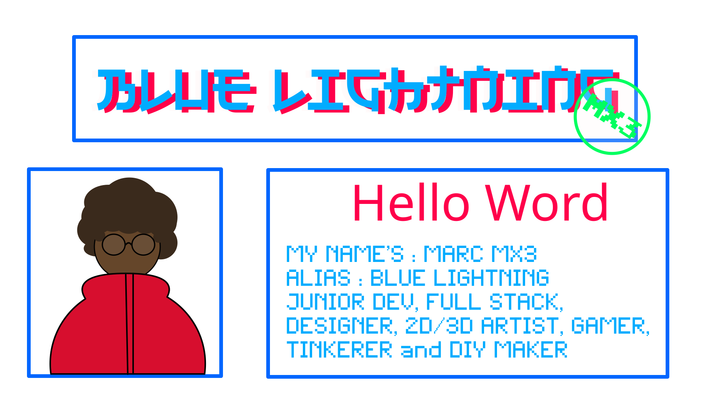

# About Me :

## Eng :

Hi! I’m Lightning, a young developer passionate about computer science, tech, science, art, video games and pop culture. A proper nerd, basically. 🤓

I’m currently finishing my bachelor’s degree in computer science, exploring many different fields and testing all kinds of things.

## Fr :

salut. moi c'est lightning, jeune dev passionner d'informatique, de tech, de science, d'art, de jeux video et de pop culture. un NERD quoi... Actuellement en fin de cycle de licence et en pleinne exploration dans diverse domaine tout en testant des tas de truc.

# Skills : 

## langage :

## environement, tools & system :

## Art and Game :

## DataBase :

## other skills :

## icon

# Project :

## Arch_Codex :

encryption and decryption system based on modern cryptography
`js` `html5` `css3` · [View on GitHub](https://github.com/Marc-Blue-Lightning/ARCH_CODEX.git)

## C-Project :
just a frontend app (without backend) for texting messenger app
`React` `Vite` · [View on GitHub](https://github.com/Marc-Blue-Lightning/C-Project.git)

# Find me online :

<!--

-->

<!---->

<!-- 

-->

